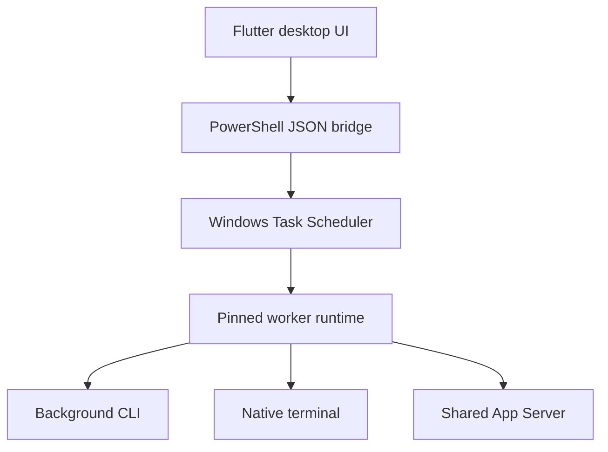

# Continuum

**A Windows desktop app for scheduling and monitoring saved Codex conversations.**

Schedule a continuation for later, see the usage windows reported for your account, and track the result from a full dashboard or a compact desktop monitor. Continuum keeps the selected conversation and repository context with the job.

**Windows · Flutter / Dart · PowerShell · Node.js · MIT**

[Getting started](docs/GETTING-STARTED.md) · [User guide](docs/USER-GUIDE.md) · [Architecture](docs/ARCHITECTURE.md) · [Documentation](docs/README.md)

## What it does

- **Schedule a saved conversation.** Choose a repository, model, access level, instruction, and time for a one-time Windows task.
- **Keep usage in view.** Full, Monitor, and Micro layouts display the usage windows and reset times Codex reports, including accounts that return only a weekly window.
- **Choose how a job runs.** Use a background worker, an interactive terminal, or a shared session with a desktop panel and an attached native terminal.
- **Follow the outcome.** Inspect live activity and saved results, with separate states for completed, failed, blocked, deferred, and cancelled jobs.
- **Customize the desktop UI.** Pin the window above other apps and adjust the Aero-inspired progress bars and appearance.

## How it works

The UI manages presentation and scheduling requests. Windows Task Scheduler launches a separate worker, which validates the saved runtime, account, repository, model, and conversation ownership before execution. Scheduled jobs keep their original runtime snapshot when the application is upgraded.

| Mode | Interaction | Optional quota continuation |
| --- | --- | --- |
| Background | Noninteractive worker with logs and saved results | Off by default; up to three eligible follow-ups |
| Native terminal | Interactive Codex CLI | No |
| Shared session | Continuum panel and a native terminal connected to one App Server | No |

Shared sessions must be started by Continuum. Retained terminals and later turns have [documented lifecycle limits](docs/SHARED-NATIVE-TUI.md).

## Engineering highlights

- **Separation of UI and execution.** A JSON subprocess boundary connects the Flutter interface to the Windows scheduling backend. [Architecture](docs/ARCHITECTURE.md)
- **Reproducible job runtimes.** Content-addressed worker snapshots and SHA-256 verification keep scheduled execution tied to the files selected when the job was created. [RuntimeBundle](components/RuntimeBundle/RuntimeBundle.psm1)
- **Explicit execution ownership.** Per-conversation worker coordination and authenticated local Shared clients prevent competing scheduler workers from starting the same conversation. [Shared protocol](components/SharedCodexSession)
- **Reusable infrastructure.** Independently importable PowerShell modules cover task registration, settings, outcomes, repository inspection, and rendering. [Component guide](components/README.md)
- **Reproducible builds.** Committed dependency locks, strict analysis, version-derived packages, and source identity metadata make review builds traceable. [Desktop guide](src/desktop/README.md)
- **Tests across the boundaries.** Node protocol mocks, PowerShell integration checks, and Flutter widget and logic tests cover their respective layers. [Test guide](tests/README.md)

## Try it

The current Flutter application is a **Windows engineering preview**. Build it from source with Windows x64, PowerShell 7, Node.js, Git, Flutter, Visual Studio's C++ desktop tools, and an installed, signed-in Codex CLI.

**[Build and open Continuum →](docs/GETTING-STARTED.md)**

The published [v1.11.0 release](https://github.com/Dukxud/Continuum/releases/tag/v1.11.0) is the earlier WinForms application. Current Flutter previews are unsigned; there is no signed production release of Continuum yet.

## Project status

Feature development is paused. The current source includes the Flutter interface, three execution modes, native Windows branding, and usage-window rendering. Windows CI and package checks are recorded in the [acceptance ledger](docs/CONTINUUM-WINDOWS-ACCEPTANCE.md). Live verification of the latest quota display and Shared session retention/approval flows remains pending.

The [project status](docs/CURRENT-STATE.md) records build evidence and remaining acceptance. Closing the app does not cancel jobs already registered with Windows Task Scheduler.

## Explore the source

| Location | Contents |
| --- | --- |
| [src/desktop/](src/desktop) | Flutter UI, Windows bridge, widget tests, and preview builder |
| [src/backend/](src/backend/) | Active scheduling backend, metadata readers, and scheduled-job entry point |
| [components/](components) | Reusable PowerShell modules and the Shared session host |
| [tests/](tests) | PowerShell and Node regression and integration tests |
| [scripts/](scripts) | Packaging, diagnostics, signing, and acceptance tools |
| [docs/](docs) | Setup, usage, architecture, and verification records |
| [legacy/winforms/](legacy/winforms/) | Retained PowerShell/WinForms interface and its launchers |

The Flutter frontend uses the backend in `src/backend/`. Preview packages and new worker snapshots preserve that layout; existing scheduled jobs retain their original saved runtimes.

## Contributing and license

See the [contribution guide](docs/CONTRIBUTING.md) for focused changes and verification commands, and [security and privacy](docs/SECURITY-AND-PRIVACY.md) for execution and data-storage boundaries.

Created by [Dukxud](https://github.com/Dukxud). Licensed under [MIT](LICENSE). Continuum is an independent project and is not affiliated with OpenAI.
