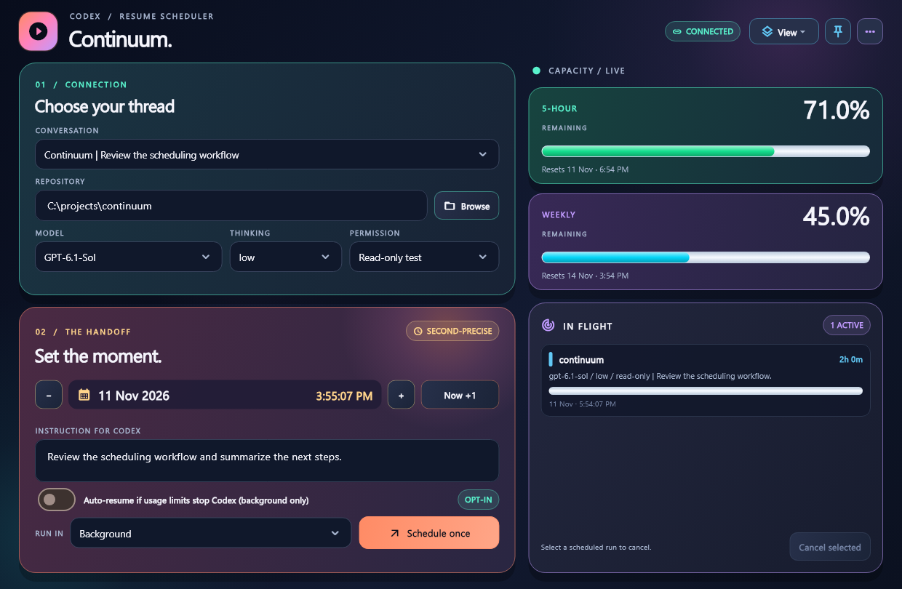
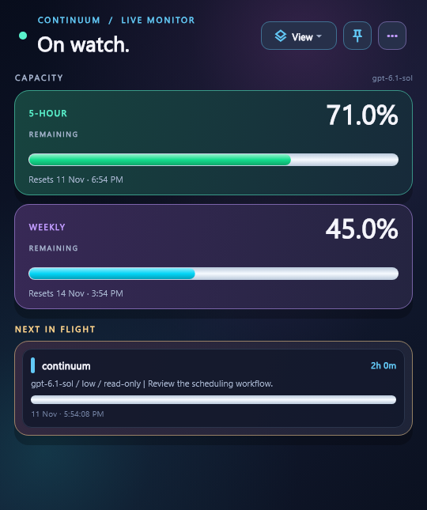
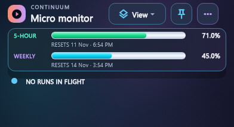
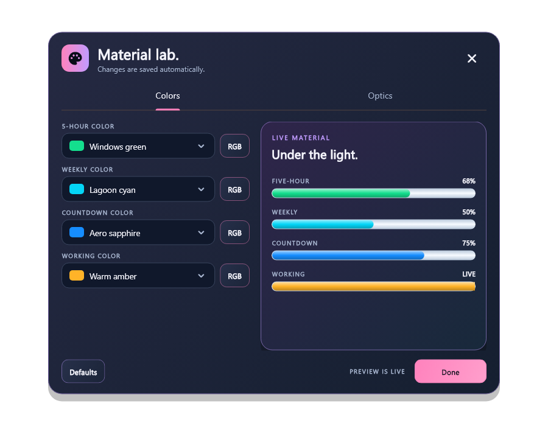
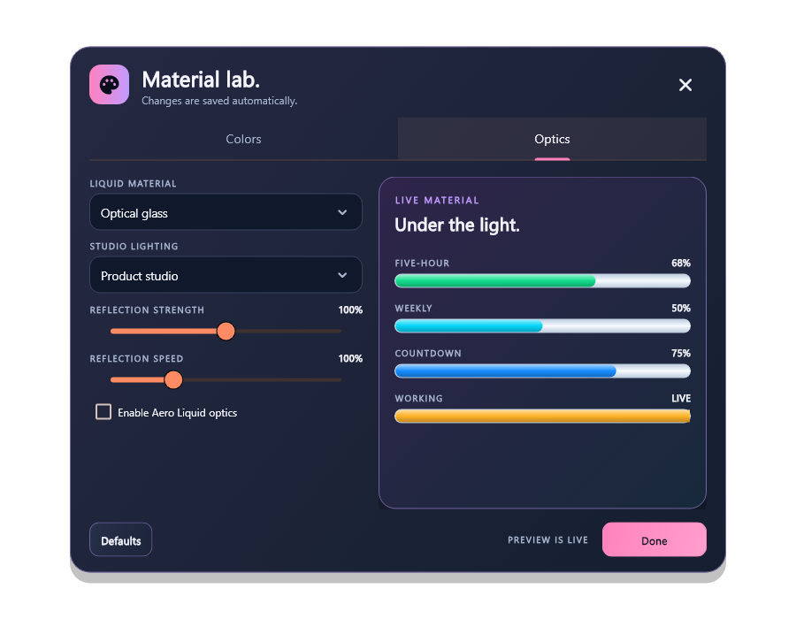

# Screenshots

The current gallery shows Continuum's actual Flutter widgets and production theme, rendered with synthetic demo data on **11 November 2026**. Conversations, repository paths, usage percentages, and upcoming work are fixtures. No private account data or live Codex turn was used.

## Full workspace

Choose a conversation, configure a continuation, and keep usage and upcoming work in view.



## Monitor and Micro

Monitor keeps capacity and upcoming work visible. Micro reduces the interface to a small desktop status display.

| Monitor | Micro |
| --- | --- |
|  |  |

## Appearance

The material editor provides independent colors and controls for finish, lighting, reflection strength, and reflection speed.

| Colors | Optics |
| --- | --- |
|  |  |

## Capture details

These are Flutter widget-renderer captures, not native Windows window captures. They show the static sprite renderer with Aero optics disabled; native title bars, live GPU animation, and actual account behavior are outside their scope. The [Windows acceptance ledger](CONTINUUM-WINDOWS-ACCEPTANCE.md) records native verification separately.

- Application: Continuum `0.1.0+1`, based on source `5520cd0085a4584f2374ccf8380bad7c05a6e45a`, with the screenshot harness update and an explicit Segoe UI dropdown font.
- Environment: Windows, Flutter `3.47.9`, Dart `3.13.7`, Segoe UI and the SDK's Material Icons font.
- Sources: [capture harness](../src/desktop/test/parity_capture_test.dart), production `SchedulerHome`, `AeroAppearanceEditor`, and the theme from `SchedulerApp`.
- [Capture manifest](screenshots/2026-11-11/capture-info.json): image dimensions, hashes, and hashes of the rendering sources.

The images are direct PNG output from the Flutter renderer. They have not been repainted, composited, or generated with an image model. Times reflect the capture moment; rerunning the harness updates the synthetic schedule and reset times.

## Reproduce the gallery

From PowerShell 7 on Windows, with Flutter on PATH:

```powershell
Set-Location .\src\desktop
$env:FLUTTER_ROOT = Split-Path -Parent (Split-Path -Parent (Get-Command flutter.bat -ErrorAction Stop).Source)
flutter pub get --enforce-lockfile
if ($LASTEXITCODE -ne 0) { throw 'Locked dependency restore failed.' }
flutter test --no-pub --tags visual-capture --update-goldens test/parity_capture_test.dart
if ($LASTEXITCODE -ne 0) { throw 'Screenshot capture failed.' }
```

The generated images are under `src/desktop/test/captures/`, which is ignored by Git. Review the images, then copy selected output into a new dated gallery folder and record its provenance. The published gallery uses `full-upcoming.png` as `full.png`, `compact-upcoming.png` as `monitor.png`, and the matching Micro and appearance files. The capture tag is excluded from ordinary correctness tests.

## Historical native evidence

The reduced, redacted BP204 crops below document a Shared-session failure observed on 6 November. The disposable task completed, its owner exited, the terminal reconnected, and the GUI retained stale Running. They are retained as defect evidence.

| Historical Live activity | Historical native terminal |
| --- | --- |
|  |  |

The owner later confirmed the corrected BP210 Micro title-bar icon. Latest live quota rendering, retained Shared terminals, and simultaneous approvals still need the native observations listed in [Windows acceptance](CONTINUUM-WINDOWS-ACCEPTANCE.md). This fixture gallery does not change that acceptance record.

For future native captures, the [read-only capture helper](../scripts/Capture-ContinuumScreenshot.ps1) saves the visible screen region of one matched window to a private local folder. Keep it unobscured and review conversations, account details, local paths, and unrelated windows before publishing. Date and label native captures separately from this fixture gallery.
