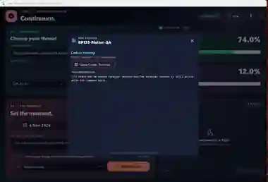
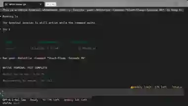

# Screenshots and visual evidence

**Current record:** [CURRENT-STATE.md](CURRENT-STATE.md). Development and screenshot collection are paused. No model run or new capture is requested by this document.

## Historical BP204 evidence — real failure, not a hero image

| Continuum Live activity | Native Codex terminal |
| --- | --- |
|  |  |

These are retained reduced/redacted crops of the operator's 6 Nov Windows capture. The disposable 90-second task completed but the original owner exited, the TUI reconnected and the GUI retained stale Running. They document the pre-fix defect; their small resolution is unsuitable for product marketing.

## Later evidence and honest limits

- **BP210:** the operator supplied a Micro screenshot showing the correct Continuum title-bar icon and accepted its merge. This verifies that observed surface/build; it does not explain why the original icon was substituted. That screenshot predates the quota fix.
- **Before BP211:** a weekly-only allowance appeared beneath a false five-hour label; this motivated #22.
- **BP211:** fixture/Windows CI and package checks passed. No live post-fix screenshot was provided before pause. Do not relabel old screenshots or CI fixture captures as live account acceptance.
- **Shared retention:** fixed-binary post-completion connection and simultaneous approvals still lack native acceptance evidence.

## Future gallery, after work resumes

Capture Full, Monitor, Micro, Appearance Colors/Optics, Shared live activity, the native attached terminal, retained completion and recent results. Use a disposable conversation where possible. Record exact commit/build/date/mode and what passed or failed. A screenshot proves one visible moment, not every execution path.

The optional read-only helper captures visible screen pixels in the matched window's bounds:

```powershell
pwsh -NoProfile -File .\scripts\Capture-ContinuumScreenshot.ps1 -Name full -WindowTitleRegex 'Continuum|Codex Resume Scheduler'
```

It requires exactly one matching visible window, writes to `%USERPROFILE%\Pictures\Continuum-QA`, refuses an existing output file and does not upload or redact. Keep the window unobscured: overlapping windows can appear because this is a screen-region capture. Native behavior remains unverified. For a terminal, select its actual title explicitly; do not assume the helper starts/attaches one.

Review/redact accounts, local paths, session IDs, prompts, repository content, usage details when private, and any unrelated applications before committing. Preserve the actual status/error under investigation. Put historical failures under `docs/screenshots/historical/`; current validated product shots must be separately dated and labeled. [Acceptance](CONTINUUM-WINDOWS-ACCEPTANCE.md) remains the test authority.
